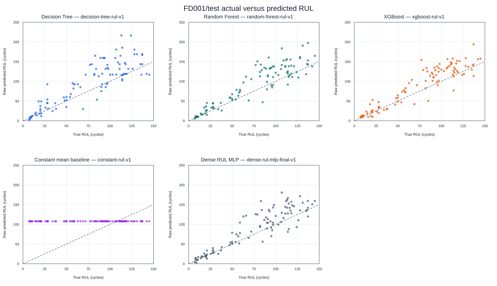
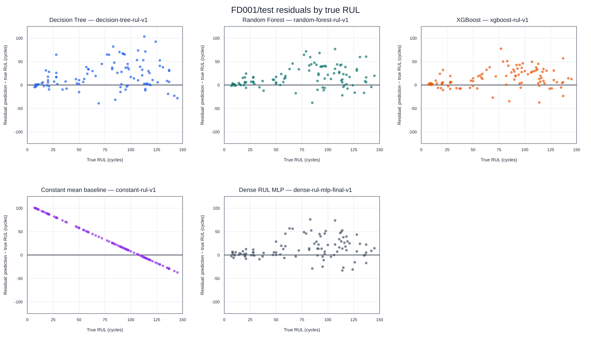
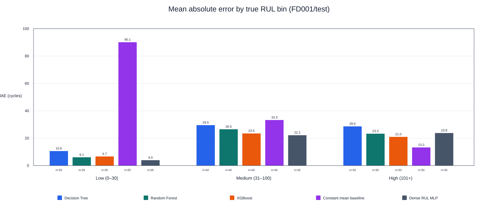

# P22 report-ready results

This note consolidates the observed P22 outputs for review and presentation. It reports the committed experiment artifacts as produced; it does not rerun model fitting or treat simulated C-MAPSS results as real fleet evidence. Every result paragraph below cites its source report and machine-readable output. The reproducible cross-check is `.venv/Scripts/python.exe scripts/audit_p22_report_results.py`; it verifies the summarized numeric claims, the saved P22 scheduler envelopes, three labeled SVG paths, and local report links.

## S1: frozen-model error by true-RUL range

Five frozen P13 model versions were evaluated on the same 100 simulated FD001/test engines at each engine's greatest observed cycle. The predeclared bins contain 25 engines at 0-30 cycles, 42 at 31-100, and 33 at 101 or more. Table values are MAE by bin and overall MAE/RMSE, all in operating cycles.

| Model version | Low MAE (cycles) | Medium MAE (cycles) | High MAE (cycles) | Overall MAE / RMSE (cycles) |
| --- | ---: | ---: | ---: | ---: |
| `constant-rul-v1` | 90.09 | 33.28 | 13.27 | 40.88 / 52.62 |
| `decision-tree-rul-v1` | 10.62 | 29.53 | 28.65 | 24.51 / 33.95 |
| `dense-rul-mlp-final-v1` | 3.96 | 22.19 | 23.79 | 18.16 / 25.57 |
| `random-forest-rul-v1` | 6.07 | 26.53 | 23.30 | 20.35 / 27.52 |
| `xgboost-rul-v1` | 6.68 | 23.47 | 20.98 | 18.45 / 24.17 |

The Decision Tree's MAE was 10.62 cycles in the low bin and 29.53/28.65 cycles in the medium/high bins; the constant baseline showed the reverse pattern, with 90.09 cycles in the low bin and 13.27 in the high bin. These are descriptive summaries of this fixed simulated test set. They do not explain model behavior causally or establish future fleet performance.

*Figure 1. Raw predictions versus true RUL, one point per FD001/test engine. Source: [S1 error diagnostics](p22_s1_error_analysis.md), model versions and paired-result provenance in that report and [`p22_s1_error_analysis.json`](figures/p22_s1_error_analysis.json).*

*Figure 2. Residual is raw prediction minus true RUL, in cycles. Source: [S1 error diagnostics](p22_s1_error_analysis.md) and [`p22_s1_error_analysis.json`](figures/p22_s1_error_analysis.json).*

*Figure 3. Binned MAE; bin counts are 25/42/33 for each model. These ranges are analysis groups, not maintenance thresholds. Source: [S1 error diagnostics](p22_s1_error_analysis.md) and [`p22_s1_error_analysis.json`](figures/p22_s1_error_analysis.json).*

## S2: validation MAE bootstrap

The saved P06 development candidates were evaluated on the same 20 held-out FD001/train engine prefixes. The experiment resampled whole engines 10,000 times with seed 42 and reports a percentile interval for aggregate MAE, in cycles.

| Model version | Observed MAE (cycles) | 95% engine-bootstrap interval (cycles) |
| --- | ---: | ---: |
| `decision-tree-rul-v1` | 22.49 | 14.36-31.06 |
| `random-forest-rul-v1` | 18.83 | 11.70-26.52 |
| `xgboost-rul-v1` | 15.11 | 9.21-22.11 |
| `constant-rul-v1` | 65.73 | 50.20-80.22 |
| `dense-rul-mlp-v1` | 15.51 | 8.70-23.68 |

These intervals describe resampling variability of validation-set aggregate MAE conditional on the saved fits. They are not individual-engine RUL intervals and do not quantify retraining variability. Source: [S2 engine-bootstrap report](p22_s2_engine_bootstrap.md), [`p22_s2_validation_bootstrap.json`](p22_s2_validation_bootstrap.json); split, feature and model hashes are recorded in the report and JSON.

## S3: artificial one-sensor sensitivity

Five saved development models were evaluated on 20 held-out FD001/train prefixes after artificial plus/minus 1% and plus/minus 5% changes to one observed sensor channel at a time. The table reports mean absolute movement of raw predictions, not error, in cycles.

| Model version | Mean movement at plus/minus 1% (cycles) | Mean movement at plus/minus 5% (cycles) |
| --- | ---: | ---: |
| `decision-tree-rul-v1` | 4.08 | 4.44 |
| `random-forest-rul-v1` | 4.03 | 4.43 |
| `xgboost-rul-v1` | 4.85 | 4.35 |
| `dense-rul-mlp-v1` | 557.96 | 2,830.33 |
| `constant-rul-v1` | 0.00 | 0.00 |

The largest observed MLP movement was 70,505.38 cycles. The large MLP responses and smaller tree/boosting responses describe sensitivity to these chosen artificial shifts only; they are not evidence about real sensor noise, faults, causes, accuracy, or maintenance. Source: [S3 sensitivity report](p22_s3_sensor_sensitivity.md) and [`p22_s3_sensor_sensitivity.json`](p22_s3_sensor_sensitivity.json), which records model versions, 20-engine inputs, per-sensor changes and provenance hashes.

## A1/A2: paired EDD and seeded-GA scheduling studies

The scheduler studies used the same frozen `decision-tree-rul-v1` raw predictions for selected simulated FD001/test engines. In A1, the 18 fixed fleet/team/buffer scenarios produced 12 EDD/GA ties and 6 GA improvements in weighted tardiness, with no regressions. A2 extended those same 18 cases across five fixed seeds for 90 paired runs: 60 ties, 30 improvements and no regressions; all schedules were feasible and repeated seeds matched. Weighted tardiness is in weighted cycles.

Fleet sizes, team counts, durations, priority weights, buffers, the soft horizon and GA configuration are declared simulation assumptions. The 120-cycle buffer is a stress setting, not a maintenance recommendation. A seeded GA improvement on this bounded scenario set does not establish general superiority or global optimality. Sources: [A1 report](p22_a1_fixed_fleet_scenarios.md), [`A1 JSON snapshot`](p22_a1_fixed_fleet_scenarios.json), [A2 report](p22_a2_seed_comparison.md), [`A2 JSON snapshot`](p22_a2_seed_comparison.json). The snapshots include the frozen P13 report hash and a verifiable envelope checksum.

## A3: history-replay timing comparison

For the saved development `decision-tree-rul-v1` and FD001/train engine 4 through cycle 164, the optimized selector preserved all ten raw/displayed predictions and their metadata exactly. Median full-fleet replay time changed from 66.43 to 53.41 ms with cache cleared, and from 33.49 to 18.77 ms with warm cache. These are local measurements on one machine and one simulated training history, not a latency target or accuracy result. Source: [A3 replay profile](p22_a3_replay_profile.md), which records the manifest/model hashes, cutoff cycles, timing method and runtime environment.

## Result-to-source audit

| Reported item | Source output | Dataset / model identity | Units and verification |
| --- | --- | --- | --- |
| S1 binned errors and Figures 1-3 | [`p22_s1_error_analysis.json`](figures/p22_s1_error_analysis.json); SVGs in `figures/` | FD001/test; five frozen P13 model versions | Cycles; checked against paired P13 outputs and the report's hashes |
| S2 observed MAE and interval | [`p22_s2_validation_bootstrap.json`](p22_s2_validation_bootstrap.json) | FD001/train; five P06 development versions; 20 held-out engines | Cycles; 10,000 whole-engine resamples, seed 42 |
| S3 prediction movement | [`p22_s3_sensor_sensitivity.json`](p22_s3_sensor_sensitivity.json) | FD001/train; five saved development model versions; 20 held-out engines | Cycles; artificial one-channel perturbations; hashes in JSON |
| A1 paired scheduler totals | [`p22_a1_fixed_fleet_scenarios.json`](p22_a1_fixed_fleet_scenarios.json) | FD001/test raw `decision-tree-rul-v1` predictions | Weighted cycles; checksum envelope and frozen P13 source hash |
| A2 paired seed totals | [`p22_a2_seed_comparison.json`](p22_a2_seed_comparison.json) | Same 18 A1 scenarios and model input; five seeds | Weighted cycles; checksum envelope, source hash, feasibility/repeat checks |
| A3 replay timing | [A3 report](p22_a3_replay_profile.md) | FD001/train engine 4; cycle 164; `decision-tree-rul-v1` | Milliseconds; repeated baseline/optimized timing and exact-output comparison |

The detailed study reports retain the complete methods, assumptions, per-engine or per-scenario values, model versions and provenance. This summary does not replace those source artifacts. NASA C-MAPSS FD001 is simulated data. None of these studies is a fault diagnosis, causal explanation, real-world maintenance validation, or safety claim.
