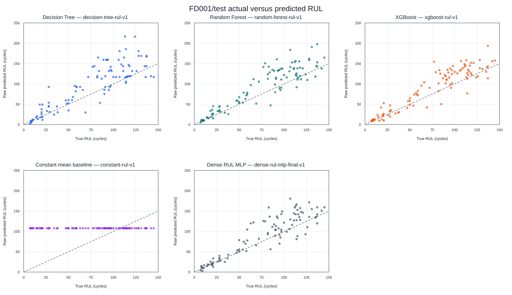
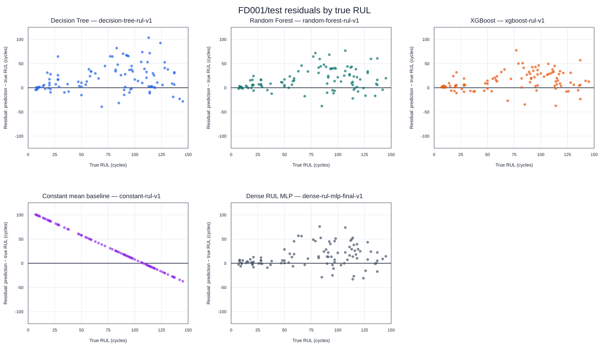
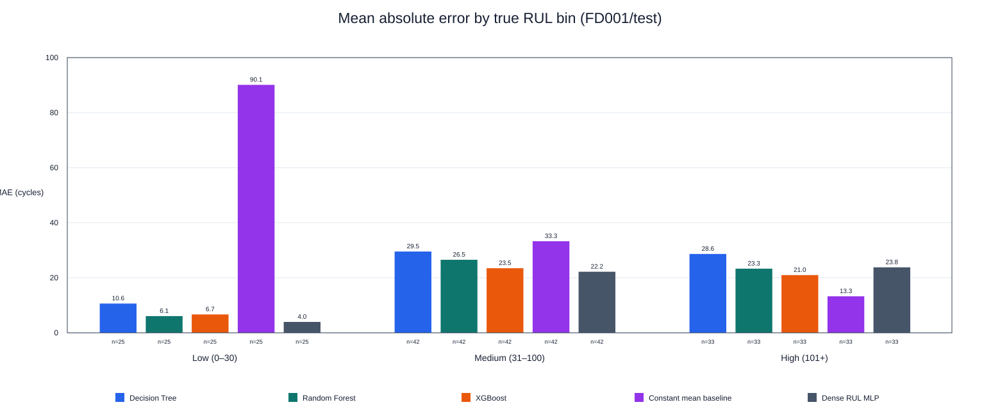

# P22-S1: FD001/test error diagnostics

**Reproduction command:** `.venv/Scripts/python.exe scripts/run_p22_s1_error_diagnostics.py --output-dir docs/figures`  
**Result:** PASS. The runner verifies the local dataset hashes, checksums and P13 source pairings, then regenerates the JSON summary and three SVG figures without fitting or changing a model.

## Declared bins and residual convention

The true-RUL bins were fixed before calculating their error summaries:

| Bin | True RUL range |
| --- | ---: |
| Low | 0–30 cycles, inclusive |
| Medium | 31–100 cycles, inclusive |
| High | 101 cycles and above |

These are analysis ranges, not maintenance thresholds. Residual is `raw prediction − true RUL`, measured in cycles. Positive means the model returned more cycles than the paired label; negative means fewer. Predictions remain raw and unclipped.

## Figures

Each dot is one of the same 100 FD001/test engines, evaluated at its greatest observed cycle. The dashed diagonal is perfect agreement; the zero line in the residual figure is exact prediction.

The grouped chart reports mean absolute error (MAE) for each bin; the counts shown below each bar are identical across models because all five use the same paired engine set.

## Observed summaries

Values below are `count / MAE cycles` in each predeclared bin. Overall values are engine-level MAE/RMSE in cycles.

| Frozen model | Low (0–30) | Medium (31–100) | High (101+) | Overall MAE / RMSE |
| --- | ---: | ---: | ---: | ---: |
| Constant mean baseline v1 | 25 / 90.09 | 42 / 33.28 | 33 / 13.27 | 40.88 / 52.62 |
| Decision Tree v1 | 25 / 10.62 | 42 / 29.53 | 33 / 28.65 | 24.51 / 33.95 |
| Dense RUL MLP final v1 | 25 / 3.96 | 42 / 22.19 | 33 / 23.79 | 18.16 / 25.57 |
| Random Forest v1 | 25 / 6.07 | 42 / 26.53 | 33 / 23.30 | 20.35 / 27.52 |
| XGBoost v1 | 25 / 6.68 | 42 / 23.47 | 33 / 20.98 | 18.45 / 24.17 |

For the Decision Tree, the low-bin MAE is 10.62 cycles on 25 engines, compared with 29.53 on the 42 medium-bin engines and 28.65 on the 33 high-bin engines. The constant mean baseline shows the reverse pattern, with 90.09-cycle MAE in the low bin and 13.27 in the high bin. These differences summarize this frozen test set; they do not establish why a model behaves that way or predict future fleet performance.

## Provenance and safeguards

- Dataset: simulated NASA C-MAPSS FD001/test, 100 engine-level labels and predictions at each engine's final observed cycle.
- Test history SHA-256: `3cda7109ce17bafb5443f2ac926cfcf88154b941b8c4cf95eb55d1ddd6f52851`.
- Separate answer-file SHA-256: `a19c8ec94931949d0485bdc35118206e9c81c4547b422efb9cf86f4ceddbceca`.
- Paired P13 payload SHA-256: `2f5a05e3015602405857950824d71399f8b9352d1ab7012129208304b4f41730`.
- The runner checked every engine ID, answer line, true RUL, raw prediction, and residual against the saved P13 results; independently recomputed overall MAE/RMSE match P13 within `1e-12` cycles. It also verified the frozen-bundle audit says the evaluated inventory matches P12 and test data was not used in training or tuning.
- Model versions: `decision-tree-rul-v1`, `random-forest-rul-v1`, `xgboost-rul-v1`, `constant-rul-v1`, and `dense-rul-mlp-final-v1`. Bundle manifest/weight checksums are recorded in [P13-S3](p13_s3_final_test_results.md) and the machine-readable P22 output `figures/p22_s1_error_analysis.json`.

This is reporting of the already-frozen P13 evaluation, not an additional selection, tuning, or refit step. C-MAPSS is simulated data; 100 engines do not represent a real fleet. The bin-wise results are descriptive subgroup metrics, not confidence bounds or individual prediction intervals, and they are not diagnosis or maintenance advice.
