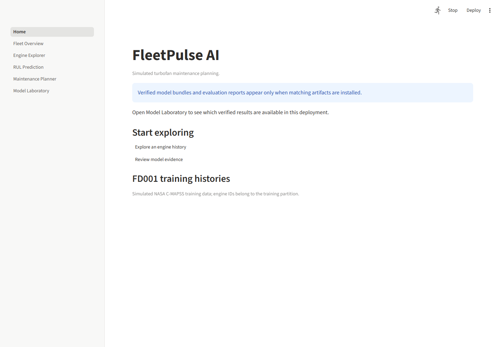
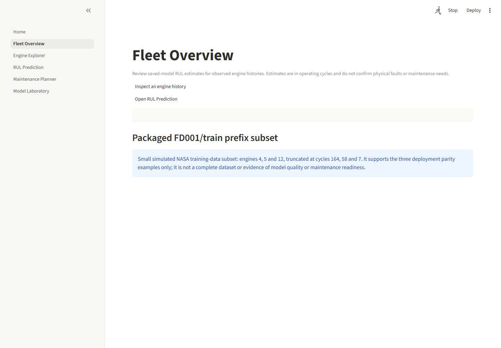
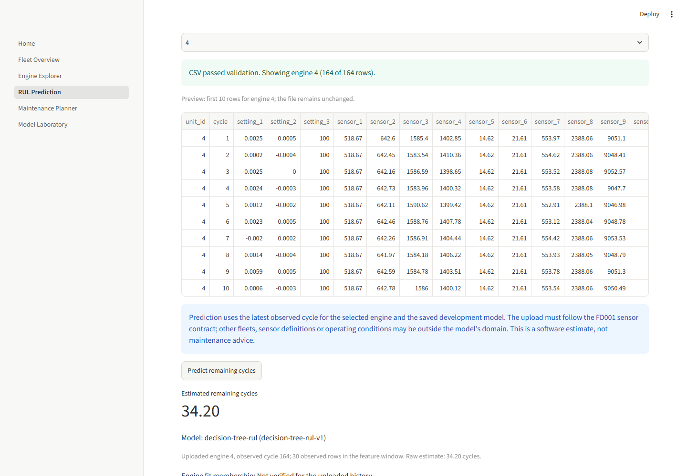
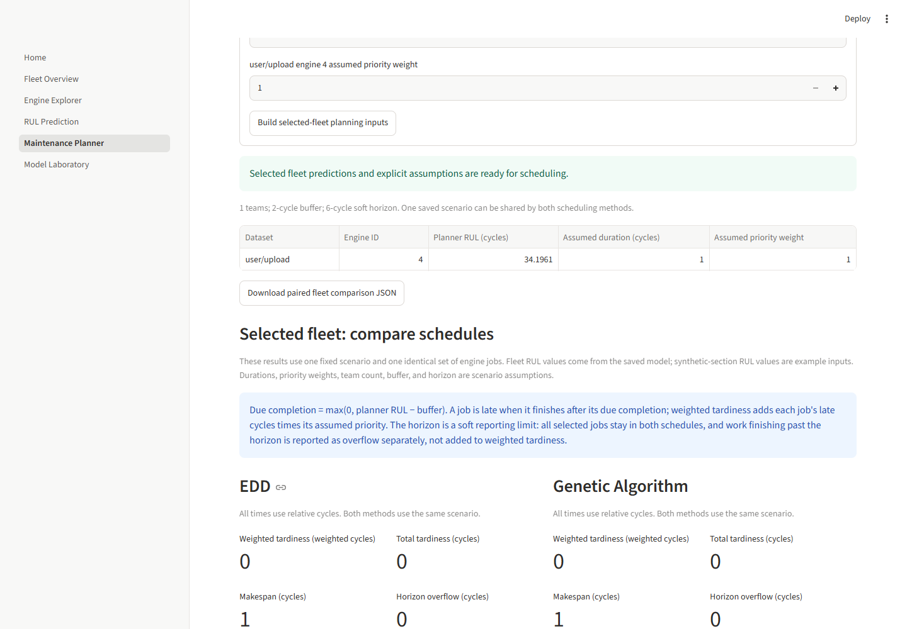

# P24-T1 local browser demo evidence

Issue: [P24-T1 #101](https://github.com/Artfever/FleetpulseAI/issues/101)

## Fresh browser and full navigation

On 2026-11-21, I started the app from the `dev` source at `491329cec3dcf9e00ec6af18c544ec140d703259` and opened it in Google Chrome 158.0.8127.36 using a new, isolated headless browser context. The local app used Python 3.12.16 and Streamlit 1.67.0. The navigation flow visited Home, Fleet Overview, Engine Explorer, RUL Prediction, Maintenance Planner, and Model Laboratory. All six page headings appeared; the five data pages had zero Streamlit exception elements, and the browser reported zero JavaScript page errors.

The local Streamlit health endpoint returned HTTP 200 with body `ok`. This is a local run; it does not establish which commit is deployed on Streamlit Cloud.

## Uploaded engine demo

The upload file was generated only in the system temporary directory from the tracked packaged `data/demo/fd001_training_prefixes.txt` history: engine 4, 164 observed rows through cycle 164, and all 26 raw-history fields. It contained no target or RUL label. The app displayed `CSV passed validation` and showed all 164 rows for engine 4.

The saved development Decision Tree v1 produced raw RUL `34.19607843137255` cycles in the service. The browser displayed `34.20` cycles for both its rounded raw estimate and its rounded display estimate, with model version `decision-tree-rul-v1`, observed cycle 164, and 30 feature-window rows. The existing real-artifact workflow test independently checks that service value and the saved model provenance.

After saving that prediction to Maintenance Planner, the browser showed the same `user/upload` engine 4 identity and planner RUL `34.1961` cycles. Using the visible default illustrative assumptions (one team, duration 1 cycle, priority weight 1, buffer 2 cycles, soft horizon 6 cycles), EDD and GA each reported weighted tardiness 0, total tardiness 0, makespan 1 cycle, and horizon overflow 0. These are schedule outputs for this one-job demonstration. Duration, weight, team capacity, buffer, and horizon are assumptions; the RUL estimate is from simulated FD001 training data.

## Screenshots

These were captured from the fresh local Chrome context during the run:










## Reproduction and automated checks

From the repository root in PowerShell:

```powershell
.\.venv\Scripts\python.exe -m streamlit run app/Home.py --server.headless true --server.port 8765 --server.address 127.0.0.1
curl.exe --silent --show-error --max-time 10 -i http://127.0.0.1:8765/_stcore/health
.\.venv\Scripts\python.exe -m ruff check .
.\.venv\Scripts\python.exe -m pytest -q tests\test_page_shells.py tests\test_p21_t1_navigation.py tests\test_upload_planner_workflow.py tests\test_upload_page.py tests\test_p20_workflow_gate.py
```

Observed results:

- Streamlit health: PASS, HTTP 200, body `ok`.
- `ruff check .`: PASS.
- Focused page-navigation, missing-page-state, upload success/error, prediction-to-planner, and paired-schedule tests: PASS, 14 passed in 23.32 seconds.
- Browser flow: PASS, six screens, upload prediction and planner handoff visible, zero page exceptions and zero JavaScript errors. Streamlit logged one nonfatal warning for the existing Observed cycle slider because both its default and session-state values are supplied; it did not prevent rendering or interaction. Carry this forward as a known issue for P24-T2. Playwright 1.65.2 was installed in the local `.venv` for this one-off run only; no project dependency was added. The temporary browser automation file was `%TEMP%\fleetpulse-p24-t1-browser-flow.py`.
- One PowerShell `Invoke-WebRequest` attempt to the health URL raised a local PowerShell `NullReferenceException`; `curl.exe` then verified the same endpoint successfully. This did not affect the browser or app run.
- Full pytest was not run; the focused suite covers the affected flows. The GitHub Development CI runs the full suite for the task PR.

## Limits

This evidence demonstrates a local browser flow with the packaged FD001/train prefix and locally available saved development model. It is not a fresh remote-browser check, a full raw-data fleet evaluation, official-test metric evidence, fault diagnosis, or maintenance advice. P23 hosted checks remain waived/unverified, and P24 gate #29 remains open.
