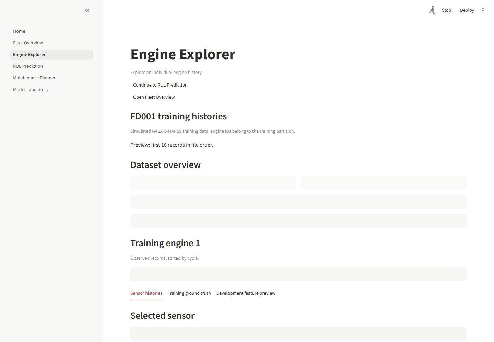
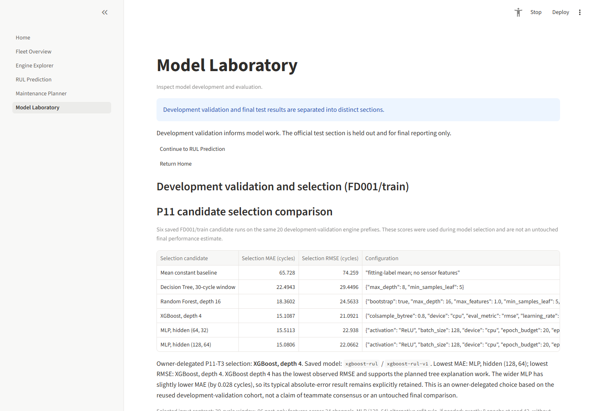
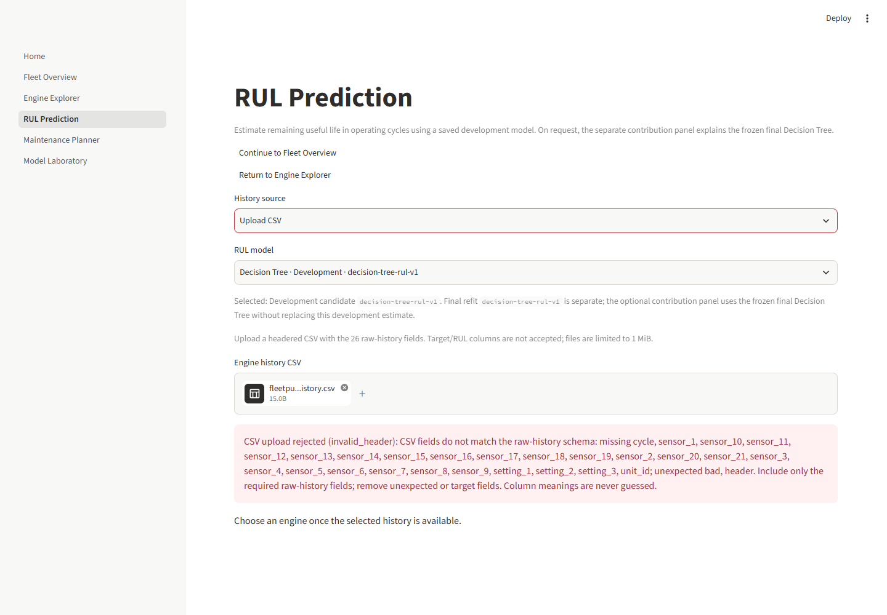
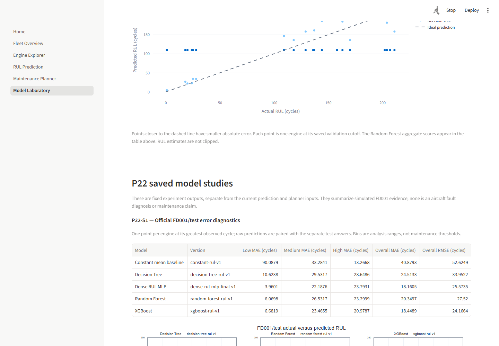
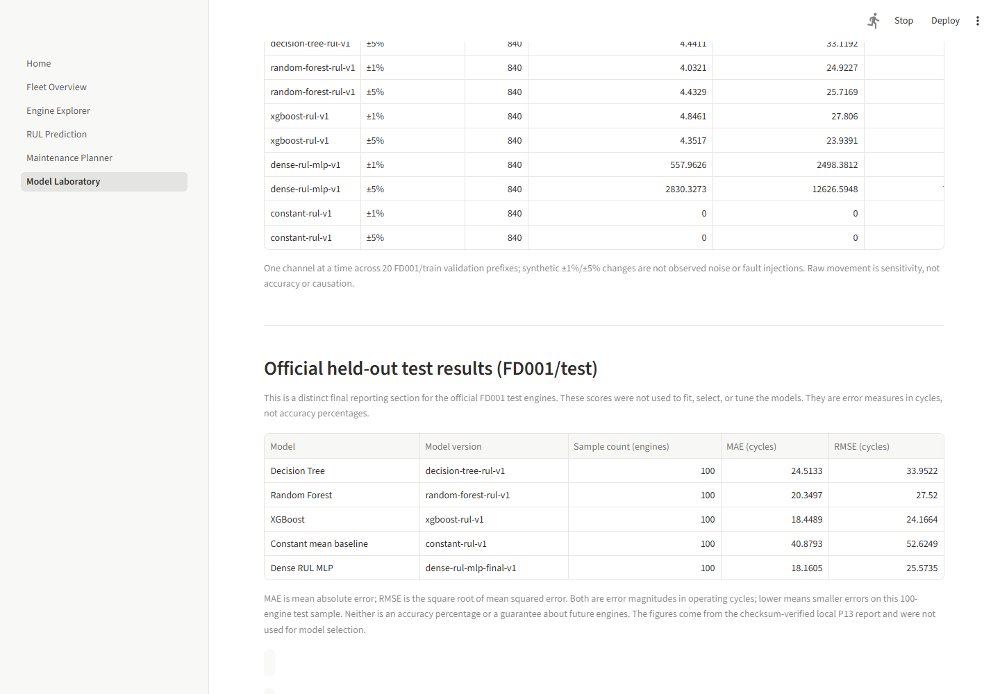

# P24-T2 screenshots, deployment URL, and known issues

Issue: [P24-T2 #178](https://github.com/Artfever/FleetpulseAI/issues/178)

## Deployment URL and verification boundary

The project URL reported by Abdullah is [https://fleetpulseai.streamlit.app/](https://fleetpulseai.streamlit.app/). Abdullah previously confirmed that he could open the deployed app and reported that it was running. This session cannot independently verify the currently hosted revision: an unauthenticated request to the Model Laboratory returned HTTP `303 See Other` with a `Location` pointing to Streamlit's sign-in flow. The app does not show a deployed Git commit in that response. Therefore these screenshots document a local run, not proof of current hosted content or commit. P23 gate #28 was closed as `NOT_PLANNED`; the hosted checks remain waived/unverified.

Local check command:

```powershell
curl.exe --silent --show-error --max-time 20 --head --dump-header - --output NUL https://fleetpulseai.streamlit.app/Model_Laboratory
```

Observed: HTTP 303; redirect target `https://share.streamlit.io/-/auth/app?...`. The local app health check separately returned HTTP 200/body `ok`.

## Captured app screens

These new screenshots were captured from the local app at `dev` commit `49e944e7913bf346c0f6104a6b7178b71d494540` in Google Chrome 158.0.8127.36, in a fresh isolated headless context, on 2026-11-21. The local environment used Python 3.12.16 and Streamlit 1.67.0. All pages rendered with zero Streamlit exception elements and zero browser JavaScript errors.











P24-T1's fresh-browser Home, Fleet Overview, successful upload, and uploaded planner comparison are documented in [P24-T1's evidence report](p24_t1_browser_demo_evidence.md) with screenshots under [`images/p24_t1/`](images/p24_t1/).

The Model Laboratory official table reads the tracked P13 result report. Its five rows report 100 engines each and are descriptive MAE/RMSE summaries in cycles; the screenshot does not represent an evaluation rerun or model selection step. The [P24-S1 result trace](p24_s1_result_trace.md) records the independent check of all 500 engine rows and all ten aggregate metrics with zero delta. The P22 study panel is also a saved historical report and does not tune from the current controls.

## Known issues and limitations

1. **Hosted revision is not independently identified here.** Abdullah reports the public app works, but this session receives Streamlit sign-in redirects and cannot see the deployed SHA. Do not treat the local screenshots as remote evidence.
2. **Original FD001 histories are not tracked in Git.** The local workspace has `data/raw/train_FD001.txt`, but `git ls-files` confirms it is not tracked. A clean clone or deployment without separately provisioned raw data cannot show the full local training-history page; the app should show its explicit unavailable state. The small packaged `data/demo/` subset and final serving bundles are distinct, tracked inputs.
3. **Observed-cycle widget log warning.** During P24-T1's local full route, Streamlit logged a nonfatal warning because the existing cycle slider supplies both a default and a session-state value. The page still rendered and worked; no exception occurred. This is a known UI warning, not evidence of incorrect predictions.
4. **Tiny saved-MLP consistency drift remains unexplained.** P24-S2 recorded 43/100 predictions changed by at most `0.0000152587890625` cycles while the current-environment rerun was exact. The cause is unproven and remains visible in [the P24-S2 report](p24_s2_frozen_evaluation.md); there was no retuning.
5. **Input and scientific limits remain.** The upload requires the exact 26-column raw-history CSV schema and rejects unknown headers, target fields, and malformed values. The invalid-header screenshot is expected validation behavior. FD001 is simulated data; estimates and scheduler assumptions are not physical fault diagnoses or maintenance recommendations. See [P14 upload rules](p14_upload_validation.md) and [course evidence limits](COURSE_COMPLIANCE.md).

## Verification commands and results

```powershell
curl.exe --silent --show-error --max-time 10 -i http://127.0.0.1:8765/_stcore/health
.\.venv\Scripts\python.exe -m ruff check .
.\.venv\Scripts\python.exe -m pytest -q tests\test_page_shells.py tests\test_p21_t1_navigation.py tests\test_upload_page.py tests\test_model_laboratory_page.py
```

- Local health: PASS, HTTP 200/body `ok`.
- Ruff: PASS.
- Focused tests for missing page states, navigation, upload validation/success/error, and Model Laboratory: PASS, 15 passed in 15.10 seconds.
- Browser screenshots: PASS, Engine Explorer, Model Laboratory, P22 panel, official held-out results, and invalid CSV error captured; zero page exceptions and zero JavaScript errors.
- Remote unauthenticated request: NOT VERIFIED; Streamlit redirected to sign-in as described above. Abdullah's reported access is recorded but does not establish the hosted revision.
- Full pytest not run for this screenshot/evidence task; regular Development CI runs the full suite on the task PR.

The workflow screenshots and values are presentation evidence for simulated FD001. They do not establish real-fleet accuracy, safety, or operational readiness. P24 gate #29 remains open.
