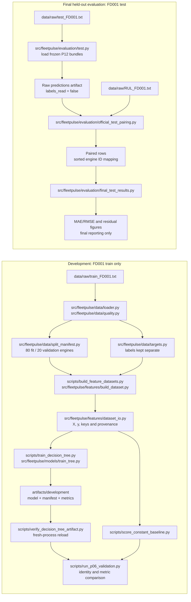

# P25-A2: Pipelines and reproduction commands

This chapter documents the pipelines visible in the source at P25-A2. The diagrams are Mermaid source embedded in this Markdown file so their node names and edges can be reviewed beside the implementation paths. It complements the [P25-A1 data/features chapter](p25_a1_data_features_architecture.md) and the repository's [FD001 provenance record](../fd001_provenance.md).

## Development training and held-out evaluation

The development flow uses complete FD001/train engine histories to form fitting examples and a fixed whole-engine manifest for validation. The official FD001/test flow is separate: predictions are created without labels, then the answer vector is paired and scored in a later step. Official-test results must not feed training or model selection.



## Online prediction and schedule comparison

The request path starts from one observed history. Feature configuration and ordered names come from the selected verified model bundle. Raw prediction and presentation fields remain distinguishable; the planner uses the successful prediction snapshot and explicit simulation assumptions.

```mermaid
flowchart LR
  User[Streamlit page or uploaded CSV] --> Input[src/fleetpulse/data/input_validation.py<br/>history and schema checks]
  Input --> Service[src/fleetpulse/services/predictor.py<br/>src/fleetpulse/services/fleet.py<br/>src/fleetpulse/services/uploaded_history.py]
  Service --> Registry[src/fleetpulse/models/registry.py<br/>selected model manifest]
  Registry --> Verify[Checksum and schema verification<br/>no fitting at request time]
  Verify --> Features[src/fleetpulse/features/config.py<br/>src/fleetpulse/features/engineering.py]
  Service --> Features
  Features --> X[Ordered past-only feature vector]
  Verify --> Model[Verified saved model bundle]
  X --> Infer[Model inference]
  Model --> Infer
  Infer --> Raw[Raw RUL estimate in cycles]
  Raw --> Context[src/fleetpulse/services/fleet.py<br/>context, warnings and identity]
  Context --> UI[Prediction or fleet display]
  Context --> Snapshot[Selected fleet prediction snapshot]
  Snapshot --> Planner[src/fleetpulse/services/planner.py]
  Planner --> Schedules[src/fleetpulse/services/schedule_comparison.py<br/>src/fleetpulse/optimization/]
  Schedules --> UI
```



## Commands to reproduce

Use Python 3.12 from the repository root. The root README's setup instructions were exercised in a clean Python 3.12.16 checkout during P24-A1. Exact outcomes from that recorded check:

- `py -3.12 -m venv .venv` — failed with launcher exit 103 because this machine registers the interpreter as Astral rather than the generic `3.12` tag.
- `uv venv --python 3.12 --seed .venv` — passed and created Python 3.12.16.
- `.venv/Scripts/python.exe -m pip install -e ".[dev,xgboost,mlp]" --extra-index-url https://download.pytorch.org/whl/cpu` — passed.
- `.venv/Scripts/python.exe -m pytest -q` — passed, 727 passed and 7 skipped in 160.06 seconds.
- `.venv/Scripts/python.exe -m ruff check .` — passed.
- `.venv/Scripts/python.exe -m streamlit run app/Home.py --server.headless true --server.port 18643`, followed by `curl.exe --fail --silent --show-error http://localhost:18643/_stcore/health` — passed; health response was `ok`.

The `py -3.12` failure is machine-specific and the README's uv fallback worked. These setup results are inherited from P24-A1's clean-clone run, not rerun in this P25-A2 worktree; the P25-A2 training and evaluation runs below were performed separately. Full raw FD001 data are not tracked. Follow `docs/fd001_provenance.md` and verify the pinned SHA-256 values before running the data commands below.

### Rebuild the development data and train/reload the P06 tree

```powershell
.venv/Scripts/python.exe scripts/run_p06_validation.py
```

This command rebuilds fitting/validation features from `data/raw/train_FD001.txt`, scores the constant-mean baseline, trains the bounded P06 Decision Tree, writes development outputs under the ignored `artifacts/development/`, reloads the tree in a fresh process, and checks its 20 validation predictions and summary metrics. It never opens the official test answers. It replaces generated P06 files under `artifacts/development/`; keep any local outputs you need before rerunning.

### Reproduce the final held-out evaluation

The P13 sequence below uses the five frozen P12 model bundles. It generates prediction rows from test histories first, pairs the answer file separately, and calculates final reporting metrics only in the last step. Choose a new output directory for each run because artifacts are immutable.

```powershell
$run = "artifacts/experiments/p13-$(Get-Date -Format yyyyMMdd-HHmmss)"
New-Item -ItemType Directory -Path $run | Out-Null
.venv/Scripts/python.exe -m fleetpulse.evaluation.test --test-data data/raw/test_FD001.txt --output "$run/official_test_predictions.json"
.venv/Scripts/python.exe -m fleetpulse.evaluation.official_test_pairing --predictions "$run/official_test_predictions.json" --rul-answers data/raw/RUL_FD001.txt --output "$run/official_test_pairings.json"
.venv/Scripts/python.exe -m fleetpulse.evaluation.final_test_results --pairings "$run/official_test_pairings.json" --output "$run/final_test_results.json" --residual-figure "$run/test_residual_histogram.html" --prediction-figure "$run/test_prediction_errors.html"
.venv/Scripts/python.exe scripts/audit_p13_metrics.py --predictions "$run/official_test_predictions.json" --rul data/raw/RUL_FD001.txt --reported "$run/final_test_results.json" --output "$run/metric_audit.json"
```

`test.py` does not accept an answer-file argument and records `labels_read: false`. `official_test_pairing.py` maps the separate answer lines to sorted test engine IDs but does not calculate scores. `final_test_results.py` is the explicit final scoring/reporting step. Do not use these final test scores to tune or select a model.

For Linux or macOS, use `.venv/bin/python` and set the run directory with `run="artifacts/experiments/p13-$(date +%Y%m%d-%H%M%S)"`; create it with `mkdir -p "$run"` and replace `$run` in the four commands above.

## Executed reproduction evidence

The commands were run in an isolated detached worktree based on dev commit `71ea87d25f703e760e6bc301332f9658a77de24c`. The three raw files were copied there only for the check; the existing ignored artifacts in the main worktree were not overwritten. SHA-256 values matched the tracked provenance: train `963b5e22825b34d8b21c69e1aeb4af3e647050eb672ee8834ba4b5d91d2de0f8`, test `3cda7109ce17bafb5443f2ac926cfcf88154b941b8c4cf95eb55d1ddd6f52851`, and RUL answers `a19c8ec94931949d0485bdc35118206e9c81c4547b422efb9cf86f4ceddbceca`.

| Check | Observed result |
| --- | --- |
| Runtime/config | Python 3.12.16, scikit-learn 1.9.1; `past-only-v1`, 30-cycle window, seed 42, Decision Tree max depth 8, minimum leaf size 5, version `decision-tree-rul-v1`. |
| Rebuilt development datasets | Fitting: 16,738 rows, 80 engines, 96 features, payload SHA-256 `6e2a0f0c28b0fbcb3afdc2b81d8f0c3aa02920617df758053d4d33f43bbb712c`; validation: 20 rows/engines, 96 features, payload SHA-256 `f843a342a3f8799a22a1d386936e9f4c2ab57b6f7cb30cc21885a2b989fcdff7`. |
| P06 trained model | Model SHA-256 `2a693e6ecc09de5d9549e287a6798fdb339c7e945c700231444f0c5bcd425018`; validation MAE 22.494269745771 and RMSE 29.449573581433 cycles. Fresh-process reload and all 20 prediction/metric comparisons passed. Engine 4/cutoff 164 predicted 34.196078 cycles against the separately held target 25; this example is one simulated validation history, not a general performance claim. |
| P13 frozen evaluation | 100 FD001/test engines × five frozen models = 500 predictions and pairings. Prediction payload SHA-256 `077fd47ec4c588fc0d4697583df37670b1fab1d5ac5f331c181ad5ce9ea59a36`; pairing payload SHA-256 `27ac8ae6ba954b9801a873f90516d834bef507c0315cb030502c6808018dc8f6`. `.venv/Scripts/python.exe scripts/audit_p13_metrics.py --predictions artifacts/experiments/p25-a2-repro-run/official_test_predictions.json --rul data/raw/RUL_FD001.txt --reported artifacts/experiments/p25-a2-repro-run/final_test_results.json --output artifacts/experiments/p25-a2-repro-run/metric_audit.json` — PASS; independently recomputed 500 rows and all ten model metrics with zero delta. |
| P13 current-environment metric example | Decision Tree MAE/RMSE 24.513306424988755/33.95219459227001 cycles; Random Forest 20.34970822712025/27.51996165541398; XGBoost 18.44893268585205/24.16644813405696; constant baseline 40.87930202123019/52.62485752612688; final MLP 18.16053291320801/25.573538664123753. |

The final MLP result differs from the older P13 record by about 0.000001 cycles in MAE and RMSE, consistent with the separately documented [P24-S2 environment-level drift](../p24_s2_frozen_evaluation.md). This run did not fit, retune, or select any final model. Four other model metric pairs matched the earlier P13 record exactly. The result artifacts remain in the temporary reproduction worktree and are not included in the report commit.

The first metric-audit invocation used the unsupported option `--rul-answers` and exited with argparse status 2; the script names this option `--rul`. The corrected command above passed. This command-line typo did not modify project files or generated results.
