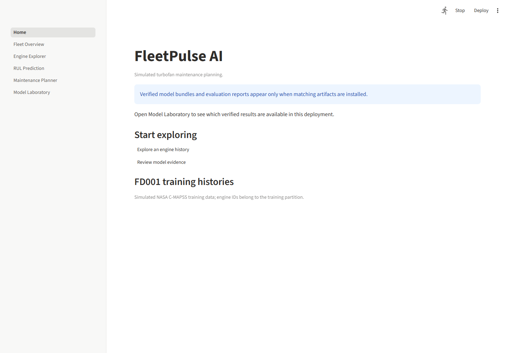
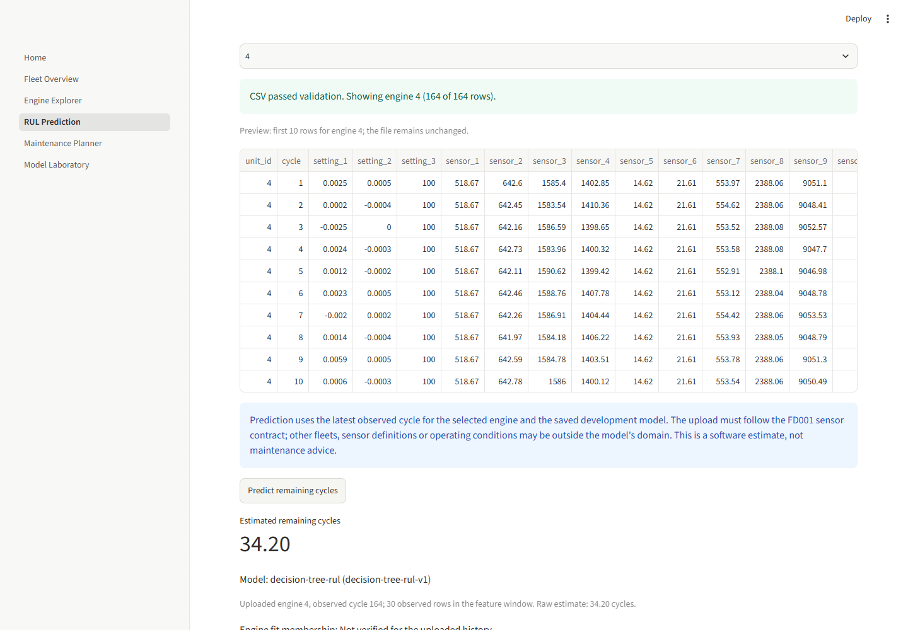
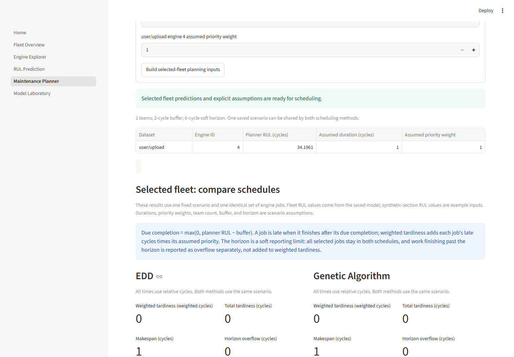
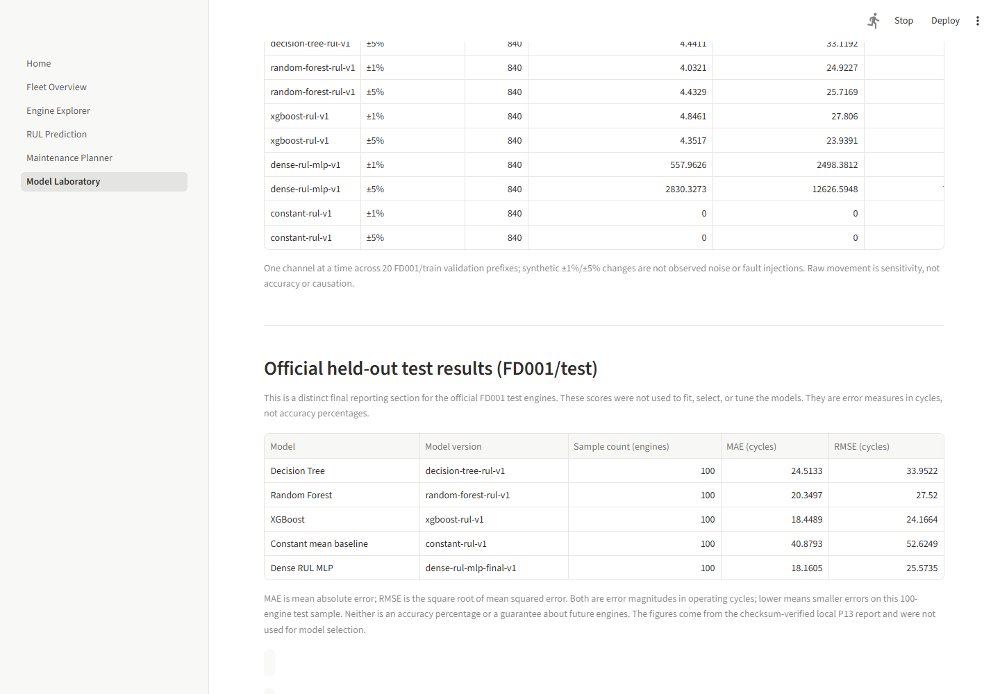

# FleetPulse AI: Remaining Useful Life Estimation and Schedule Comparison

**Course project report · Phase P25 assembly**  
**Scope:** software-only Path A using simulated NASA C-MAPSS FD001 data  
**Status:** assembled from the evidence-linked chapters listed below; final group review and export sign-off remain pending.

## Abstract

FleetPulse is a Streamlit prototype that turns an observed turbofan-engine history into a remaining useful life (RUL) estimate in operating cycles. It also compares two maintenance-job ordering methods under explicit user-supplied assumptions. The project uses simulated NASA C-MAPSS FD001 trajectories; it does not use records from aircraft in service. Its output is neither a physical fault diagnosis nor a maintenance recommendation.

The system separates raw-history validation, past-only feature construction, saved-model inference, presentation, and schedule simulation. Development model choices use a fixed engine-level validation split. Final FD001/test predictions are paired with their separate answers only after prediction, and the resulting metrics are reported without further model selection. On the 100 simulated test engines, the dense MLP has the lowest MAE (18.1605 cycles) and XGBoost the lowest RMSE (24.1664 cycles). EDD and a seeded Genetic Algorithm (GA) were compared on fixed schedule scenarios; those comparisons use assumed durations, priorities, capacity, buffers, and horizons.

## 1. Problem and intended users

Engine sensor histories change over operating cycles. A user may want a compact estimate of how many cycles remain in a simulated engine history and a way to explore how a fleet of example jobs might be ordered. FleetPulse packages these steps in a navigable application and preserves the evidence behind the values it displays.

The intended users are course evaluators and project teammates who need to inspect the pipeline, compare saved model outputs, and demonstrate how estimates flow into a scheduling comparison. A user can also upload a single-engine history with the exact FD001 raw schema. The system is an educational decision-support prototype: its simulated results are not suitable for operational aircraft maintenance decisions.

## 2. Objectives and Path A mapping

This project follows software-only **Path A**: implement and document an AI application over the supplied simulated benchmark, with traceable experiments and a repeatable demonstration.

| Objective | Implemented evidence | Boundary |
| --- | --- | --- |
| Validate and inspect observed engine histories | FD001 loader, history checks, Engine Explorer, and exact-schema CSV upload | Full raw NASA files are not tracked; only the documented demo subset and separately provisioned local data are available. |
| Estimate RUL from past observations | Versioned 96-feature pipeline and verified saved model bundles | Predictions are cycle estimates on simulated FD001 data, not diagnoses. |
| Compare model behavior with reproducible evidence | Fixed whole-engine development split, frozen candidates, held-out evaluation and metric audit | The official test scores are reporting-only and do not establish real-fleet performance. |
| Explain a model output and its limits | Optional frozen-tree SHAP contribution view and captions | Attribution is not causation or a fault explanation. |
| Compare maintenance-job ordering | Shared-scenario EDD and seeded GA comparison | Durations, priorities, team count, buffer and horizon are simulation assumptions. |
| Make the work inspectable | Streamlit screens, source-linked report chapters, screenshots, setup and reproduction instructions | A clean clone may need separately provisioned full datasets or local development artifacts. |

## 3. Product and user journey

The application presents six screens: Home, Fleet Overview, Engine Explorer, RUL Prediction, Maintenance Planner, and Model Laboratory. Together they support two routes: inspect packaged fleet examples and saved-model evidence, or upload a single observed history and carry its prediction into the planner.

### Packaged fleet route

1. Open Fleet Overview and select the packaged FD001/train prefix subset.
2. Inspect the three dataset-qualified engine histories and their saved Decision Tree estimates.
3. Review the observed-cycle and feature-window metadata and the warning on the short history.
4. Save selected successful predictions as planner inputs and view the paired EDD/GA schedule comparison.

The packaged subset contains only engines 4, 5, and 12, truncated at cycles 164, 58, and 7. It is a parity demonstration subset, not a complete fleet or a model-quality sample.

### Uploaded-history route

1. Open RUL Prediction and choose CSV upload.
2. Upload one headered history with exactly the 26 raw FD001 fields and no target/RUL column.
3. Choose the dataset-qualified history/model context and request prediction.
4. Inspect validation status, raw/display estimate, model version, observed cutoff, and rows used for features.
5. Save the successful prediction to Maintenance Planner, set illustrative schedule assumptions, and compare EDD with GA on the same scenario.

The recorded local browser run used a 164-row packaged FD001/train engine-4 prefix through cycle 164. The service returned raw RUL `34.19607843137255` cycles, displayed as `34.20`; the planner retained the engine/model context. With one team, duration 1, priority 1, buffer 2, and horizon 6 (all illustrative assumptions), both methods scheduled the one job with zero tardiness, a one-cycle makespan, and no overflow. This is a demonstration output, not an accuracy or maintenance result.

The Model Laboratory separates development validation and final held-out test results. Its official-test section displays five frozen model rows, each scored on 100 engines, and clearly labels MAE/RMSE as errors in cycles. A separate P22 studies section contains descriptive diagnostics; it must not be confused with the final score table.

Browser capture details, environment versions, routes, observed results, and local-only limitations are in [P24-T1 browser evidence](../p24_t1_browser_demo_evidence.md) and [P24-T2 screenshots and known issues](../p24_t2_screenshots_known_issues.md).

## 4. Data, features, and architecture

FD001 has 26 raw fields: unit ID, cycle, three operating settings, and 21 sensors. Train and test unit numbers can overlap, so engine identity includes the partition. For a complete training engine with final cycle `L`, a row at cycle `t` has separate target `L − t`. Neither engine identity, cycle, complete lifetime, nor true RUL enters the model feature vector.

The development manifest holds out 20 whole training engines from fitting (80 fitting, 20 validation; seed 42). Validation predictions use only rows through the saved cutoff; complete lifetime is used separately to compute the validation answer. The `past-only-v1` feature contract summarizes 24 reading channels in fixed order using latest, arithmetic mean, population standard deviation, and least-squares slope against actual cycle numbers. The default inclusive window covers up to the 30 observed cycles ending at the selected cutoff, yielding 96 ordered features. No future rows or imputed cycle gaps are introduced.

At request time, validation checks the history, the selected saved bundle supplies the feature schema/order, and the service returns raw RUL with explicit model/history context. Presentation may separately clamp a displayed value; planner RUL and the raw evaluation value remain distinguishable. The application loads verified bundles and does not retrain models during a prediction request.

The data/feature contracts and implementation map are detailed in [P25-A1](p25_a1_data_features_architecture.md). Training, held-out evaluation, online prediction, schedule flow, and exact reproduction commands are in [P25-A2](p25_a2_pipeline_and_reproduction.md).

## 5. Models and evaluation

Candidate selection used the fixed 20-engine development validation cohort. The selected saved model was XGBoost based on validation RMSE; the final held-out test scores below were not used to change that selection. Five frozen bundles were evaluated on the same 100 FD001/test engines after raw predictions were produced and paired with the separate RUL answers.

| Frozen model | Version | Engines | MAE (cycles) | RMSE (cycles) |
| --- | --- | ---: | ---: | ---: |
| Decision Tree | `decision-tree-rul-v1` | 100 | 24.513306424988755 | 33.95219459227001 |
| Random Forest | `random-forest-rul-v1` | 100 | 20.34970822712025 | 27.51996165541398 |
| XGBoost | `xgboost-rul-v1` | 100 | 18.44893268585205 | **24.16644813405696** |
| Constant mean baseline | `constant-rul-v1` | 100 | 40.87930202123019 | 52.62485752612688 |
| Dense RUL MLP | `dense-rul-mlp-final-v1` | 100 | **18.160531787872316** | 25.573537464442705 |

MAE averages absolute cycle error; RMSE gives larger residuals more influence by squaring them before averaging. The MLP leads on MAE and XGBoost on RMSE, so neither metric supports a single universal winner. An independent audit joined all 500 engine rows and recomputed all ten aggregate metrics with zero difference from the recorded report.

The optional SHAP example explains one frozen-tree output: packaged FD001/train engine 4 through cycle 164 had raw RUL 29.7941 cycles against a 126.9361-cycle reference. The largest listed contributions were `sensor_13_mean` at +6.5856 cycles and `sensor_4_mean` at −29.4441 cycles. They describe model attribution relative to that reference, not physical causes.

Full model settings, residual and RUL-bin figures, bootstrap intervals, sensitivity results, attribution method, and source hashes are in [P25-S1](p25_s1_model_evaluation_scheduling.md) and the [P25-S2 evidence captions](p25_s2_evidence_captions.md).

## 6. Schedule comparison

The planner computes due completion as `max(0, planner RUL − buffer)` and lateness from job completion time. Weighted tardiness sums each job's late cycles times its assumed priority. The horizon is a soft reporting limit: selected jobs remain visible and overflow is reported separately.

On 18 fixed simulated fleet/team/buffer scenarios, GA tied EDD 12 times and improved weighted tardiness 6 times, with no regressions. Across five seeds per scenario (90 paired comparisons), it tied 60, improved 30, and regressed zero times. These bounded results do not prove that GA is always better or globally optimal. NASA FD001 contains no maintenance durations, priorities, team capacities, or maintenance outcomes; those are explicit scenario assumptions.

## 7. Reproduction, provenance, and limitations

Use Python 3.12 and follow the setup and commands in [README](../../README.md), [setup guide](../SETUP.md), and [P25-A2 reproduction chapter](p25_a2_pipeline_and_reproduction.md). Full raw FD001 histories are not tracked; acquire and verify them using [FD001 provenance](../fd001_provenance.md). The reported P13 figures map to the saved reports, frozen versions, split, source hashes, and independent audit in [P25-S2](p25_s2_evidence_captions.md).

The screenshots and browser record document a local app run. They do not identify the current Streamlit Cloud commit. NASA C-MAPSS is simulated data; a 100-engine test sample does not establish performance on real aircraft. The model does not provide a validated per-engine uncertainty interval, fault cause, safety guarantee, or maintenance benefit. Scheduling scores depend on illustrative assumptions and are not operational recommendations. Exported PDF/PowerPoint layout and group defense remain subject to the human review recorded in the task handoffs.

## Source chapters and evidence map

- [Editable final presentation](../slides/p25_final_deck.md) · [10-page PDF export](../../output/pdf/p25_final_deck.pdf)
- [Data, targets, features, and service architecture](p25_a1_data_features_architecture.md)
- [Pipelines, diagrams, and reproduction commands](p25_a2_pipeline_and_reproduction.md)
- [Models, evaluation, SHAP, and schedule results](p25_s1_model_evaluation_scheduling.md)
- [Captioned figures, exact results, and provenance](p25_s2_evidence_captions.md)
- [Local browser demo evidence](../p24_t1_browser_demo_evidence.md)
- [Screenshots, official-results screen, and known issues](../p24_t2_screenshots_known_issues.md)
