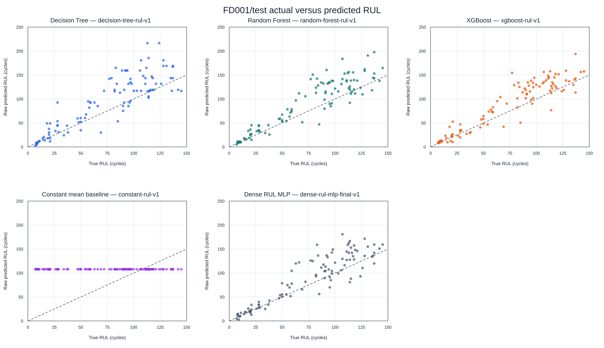
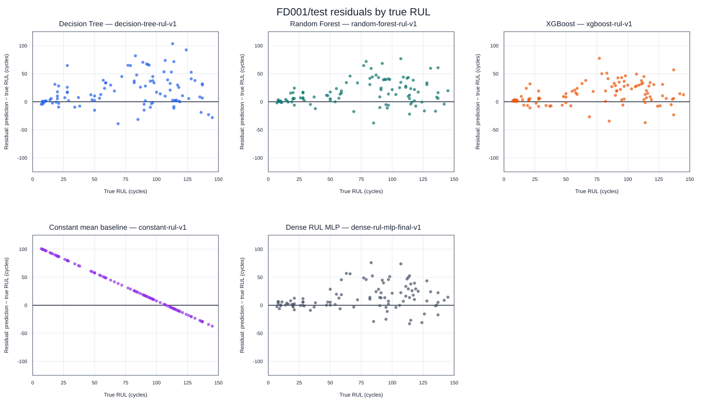
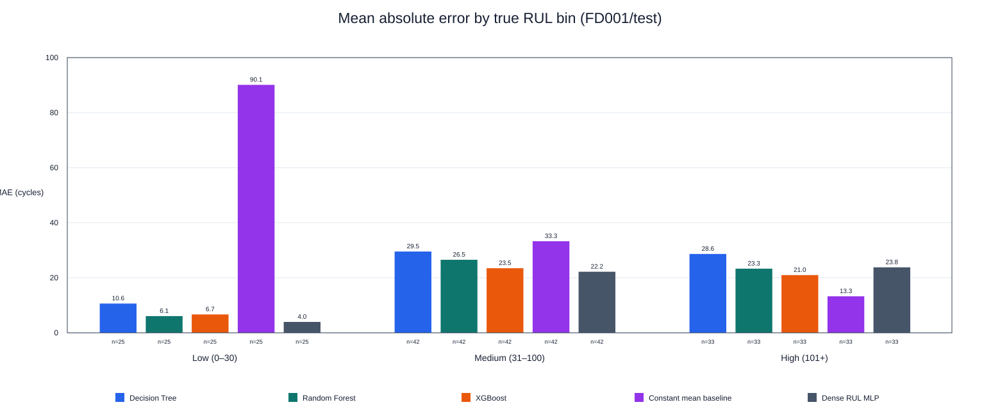

# Models, evaluation, explanations, and scheduling

Report material for P25-S1 / [issue #103](https://github.com/Artfever/FleetpulseAI/issues/103). This chapter consolidates checked model and planning results already recorded in the repository. It does not retrain or retune a model. NASA C-MAPSS FD001 is simulated turbofan data; all RUL values and errors below are in operating cycles unless marked as weighted cycles.

## Model comparison and selection

The development candidates use the shared ordered 96-feature `past-only-v1` representation and the same 20 held-out `FD001/train` engine prefixes. Their scores are development-selection evidence, not an untouched final performance estimate.

| Candidate | Validation MAE (cycles) | Validation RMSE (cycles) | What the record says |
| --- | ---: | ---: | --- |
| Mean constant baseline | 65.728002 | 74.258987 | Reference with no sensor features |
| Decision Tree, 30-cycle window | 22.494270 | 29.449574 | Interpretable tree baseline |
| Random Forest, depth 16 | 18.360242 | 24.563262 | Lower error than the single tree on this cohort |
| XGBoost, depth 4 | 15.108697 | **21.092113** | Lowest validation RMSE; selected for the next production-integration candidate |
| MLP, hidden `(64, 32)` | 15.511258 | 22.937993 | Neural candidate |
| MLP, hidden `(128, 64)` | **15.080604** | 22.066152 | Lowest validation MAE, but RMSE is 0.974039 cycles above XGBoost |

The recorded P11 decision selects XGBoost depth 4 because it has the lowest squared-error score and supports the planned tree-based explanation work. That selection gives up the wider MLP's 0.027907-cycle MAE advantage on the reused validation cohort. The MLP result is retained rather than hidden. See [P11 model-selection decision](../p11_t3_model_selection_decision.md) and the [P11 comparison manifest](../../artifacts/selection_manifest.json).

The P11 architecture comparison held the other MLP settings fixed: seed 42, batch size 128, Adam learning rate 0.001, MSE loss, CPU, at most 20 epochs, and patience 3. For `(128, 64)`, the best validation MSE was 486.915088 cycles squared at epoch 8 after 11 epochs were trained. The final MLP refit froze that architecture and epoch count; it did not use validation for early stopping. A `StandardScaler` was fit on 20,631 past-only feature rows from all 100 `FD001/train` engines; the final network was then fit on complete training-engine trajectories with uncapped per-row RUL labels. It uses the same 96-feature schema, seed 42, ReLU hidden layers, CPU and saved scaler. The scaler, weights, configuration, and source lineage are stored in a separately verified bundle. See [P11 MLP settings](../p11_s2_mlp_settings.md), [P12 scaler](../p12_s1_final_mlp_scaler.md), [P12 fixed-epoch refit](../p12_s2_final_mlp_refit.md), and [P12 MLP bundle](../p12_s3_final_mlp_bundle.md).

## Final held-out test results

After model fitting and selection were frozen, the five P12 bundles each produced one raw prediction for each of 100 `FD001/test` engine histories. The test answers were read later and paired to engines by sorted ID. The independent P13 audit checked all 500 prediction/label rows and recomputed all ten aggregate metrics with zero delta. No test result was used to select, tune, or refit a model.

| Frozen model | Version | Engines | MAE (cycles) | RMSE (cycles) |
| --- | --- | ---: | ---: | ---: |
| Decision Tree | `decision-tree-rul-v1` | 100 | 24.513306424988755 | 33.95219459227001 |
| Random Forest | `random-forest-rul-v1` | 100 | 20.34970822712025 | 27.51996165541398 |
| XGBoost | `xgboost-rul-v1` | 100 | 18.44893268585205 | 24.16644813405696 |
| Constant mean baseline | `constant-rul-v1` | 100 | 40.87930202123019 | 52.62485752612688 |
| Dense RUL MLP | `dense-rul-mlp-final-v1` | 100 | **18.160531787872316** | 25.573537464442705 |

On this held-out simulated test set, the MLP has the lowest MAE and XGBoost has the lowest RMSE. Those are different summaries of error: MAE averages absolute cycle differences, while RMSE penalizes larger residuals more strongly. This final reporting comparison does not replace the earlier development decision or establish how either model will perform on new engines. See [P13 final results](../p13_s3_final_test_results.md) and the [independent row and metric audit](../p13_a2_independent_metric_audit.md).

*Figure 1. Each point is one test engine at its last observed cycle. The diagonal indicates equality; it is not a confidence band. Source: [P22 error diagnostics](../p22_s1_error_analysis.md).*

## Error patterns and validation variability

P22 grouped the same 100 held-out test engines by true RUL: low 0–30 cycles (25 engines), medium 31–100 (42), and high 101+ (33). These are analysis bins, not maintenance thresholds. The Decision Tree's MAE was 10.62, 29.53, and 28.65 cycles across the three bins; the constant baseline was 90.09, 33.28, and 13.27. The MLP's corresponding values were 3.96, 22.19, and 23.79 cycles. Errors therefore vary by RUL range and model. The bins describe this fixed simulated test sample; they do not explain causes or predict future-fleet results.

*Figure 2. Residuals remain unclipped and are measured in cycles; zero is exact agreement. Source: [P22 error diagnostics](../p22_s1_error_analysis.md).*

On the 20 saved development-validation engines, P22 resampled whole engines 10,000 times with seed 42. The Decision Tree's observed MAE was 22.49 cycles (95% aggregate-MAE bootstrap interval 14.36–31.06); XGBoost was 15.11 (9.21–22.11); final development MLP was 15.51 (8.70–23.68). These intervals describe variability in aggregate validation MAE conditional on the saved model fits. They are not intervals for an individual engine, do not include retraining variability, and are not final-test confidence claims. P22 also perturbed one observed sensor at a time by artificial ±1% and ±5% changes: average raw-output movements were about 4–5 cycles for the tree/boosting models, but 557.96 and 2,830.33 cycles for the development MLP. This is a sensitivity test to chosen artificial changes, not evidence of actual sensor noise, accuracy, or faults. See [P22 report-ready results](../p22_report_results.md), [engine bootstrap](../p22_s2_engine_bootstrap.md), and [sensor sensitivity](../p22_s3_sensor_sensitivity.md).

*Figure 3. Binned MAE in cycles. RUL bands are descriptive analysis groups. Source: [P22 error diagnostics](../p22_s1_error_analysis.md).*

## What the SHAP explanation means

The optional P17 explanation uses the frozen final Decision Tree and a fixed reference of 100 `FD001/train` prefixes ending at cycle 90. For packaged training engine 4 through cycle 164, it returned raw RUL 29.7941176471 cycles against a 126.9360964740-cycle reference baseline. The largest positive listed contribution was `sensor_13_mean` at +6.5856 cycles; the largest negative was `sensor_4_mean` at −29.4441 cycles. The baseline plus all 96 signed feature contributions reconstructs the raw output within the recorded floating-point tolerance.

A positive contribution means that this feature value moved this tree's output above its reference baseline; a negative value moved it below. It does not mean the sensor caused wear, identify a fault, or predict the effect of changing a sensor. The reference distribution and interventional SHAP assumption matter, and correlated feature combinations may not represent physically observed engines. This is one model attribution for one observed simulated history, not an accuracy measure or causal explanation. See [P17 explanation output and method](../p17_s1_final_tree_explanations.md) and [plain-language limits](../p17_t3_plain_language_limits.md).

## Scheduling results are conditional on assumptions

The planner consumes raw model RUL through a separate nonnegative planner value. For each selected job, due completion is `max(0, planner RUL − buffer)`. A job is late when its service finishes after that due cycle; weighted tardiness is the sum of late cycles multiplied by a chosen priority weight. The horizon is a soft reporting limit: jobs are not dropped, and overflow is reported separately from tardiness.

For the hand-checked synthetic Appendix B example, A/B/C have RUL values 4/5/8 cycles, service durations 3/1/2 cycles, priority weights 1/5/1, one team, a 2-cycle buffer, and a 2-cycle horizon. EDD orders A/B/C and scores 6 weighted cycles of tardiness; the seeded Genetic Algorithm orders B/A/C and scores 2. Both schedules include all jobs and have 4 cycles of aggregate horizon overflow. These RULs, durations, priorities, capacity, buffer, and horizon are example assumptions; they are not real predictions or measured maintenance facts.

Across 18 fixed P22 fleet/team/buffer scenarios, GA tied EDD 12 times and improved weighted tardiness 6 times, with no regressions. Across five fixed seeds per scenario (90 paired runs), GA tied 60 times, improved 30, and regressed zero times; all schedules were feasible and repeated seeds matched. One stress scenario used a 120-cycle buffer. This bounded result does not establish that GA is generally better or globally optimal. Durations and weights were supplied for the simulation; the NASA dataset has no maintenance-team, service-time, or priority labels. See [P18 scheduling contract](../p18_scheduling_contract.md), [P20 assumptions and overflow](../p20_t3_assumptions_and_overflow.md), and [P22 fixed-scenario and seed studies](../p22_a1_fixed_fleet_scenarios.md) / [seed comparison](../p22_a2_seed_comparison.md).

## Evidence and limitations

- Data scope: simulated NASA C-MAPSS FD001 only; this report contains no real-aircraft observations.
- Units: predicted and true RUL, absolute errors, residuals, and service timing are operating cycles. Weighted tardiness is weighted cycles.
- Leakage control: engine-level development split; prediction features contain only observed prefixes. Official test labels were paired only after frozen prediction outputs existed.
- Reproduction: source reports record commands, software versions, file/model/config hashes, and whether ignored local data/artifacts are needed. A clean clone may not contain the original full histories or model bundles.
- Model limitations: the development cohort has 20 validation engines; the test set has 100 simulated engines. These results do not establish accuracy on real engines, uncertainty for one engine, reliability, causality, diagnosis, or maintenance benefit.
- Schedule limitations: model output supplies only an illustrative RUL input. Duration, weight, teams, buffers, and horizon are assumptions; no optimized schedule is an operational recommendation.

### Source records

- [P11 candidate decision and trade-off](../p11_t3_model_selection_decision.md)
- [P11 MLP settings](../p11_s2_mlp_settings.md), [P12 scaler](../p12_s1_final_mlp_scaler.md), [P12 refit](../p12_s2_final_mlp_refit.md), and [P12 bundle](../p12_s3_final_mlp_bundle.md)
- [P13 held-out results](../p13_s3_final_test_results.md) and [independent metric audit](../p13_a2_independent_metric_audit.md)
- [P22 report and source map](../p22_report_results.md)
- [P17 SHAP report](../p17_s1_final_tree_explanations.md)
- [P18 scheduling rules](../p18_scheduling_contract.md), [P20 planner assumptions](../p20_t3_assumptions_and_overflow.md), and [P22 scheduler runs](../p22_a1_fixed_fleet_scenarios.md) / [P22 seed runs](../p22_a2_seed_comparison.md)
