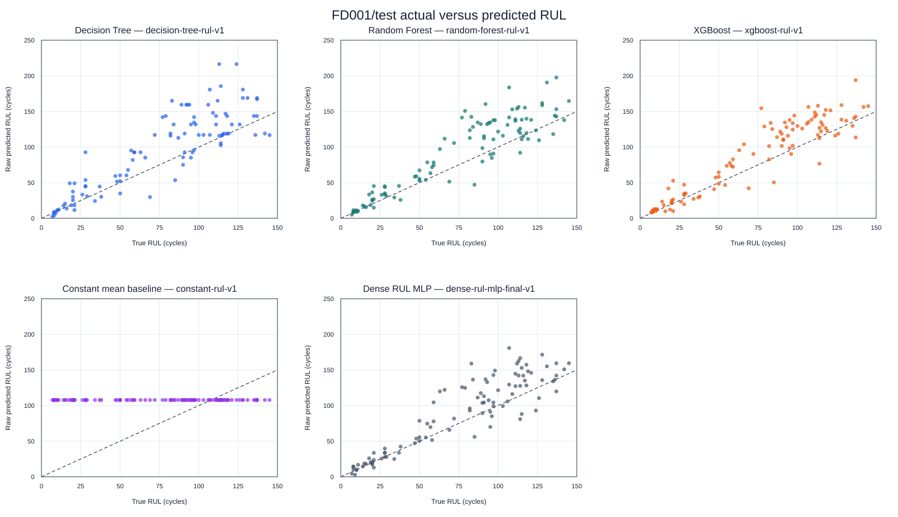
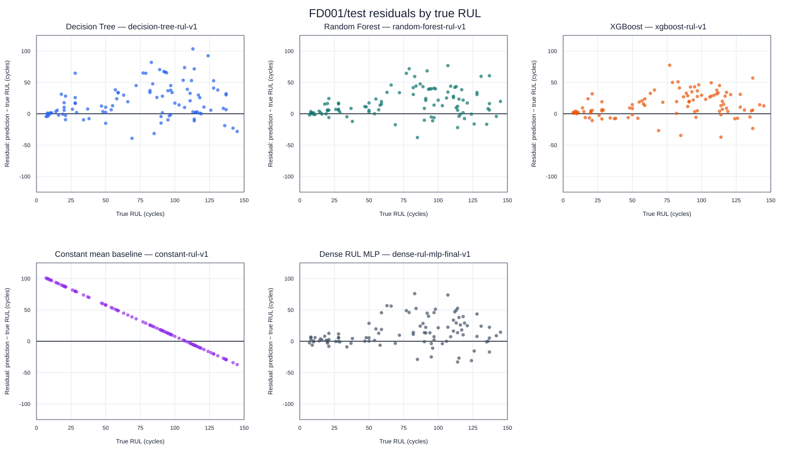
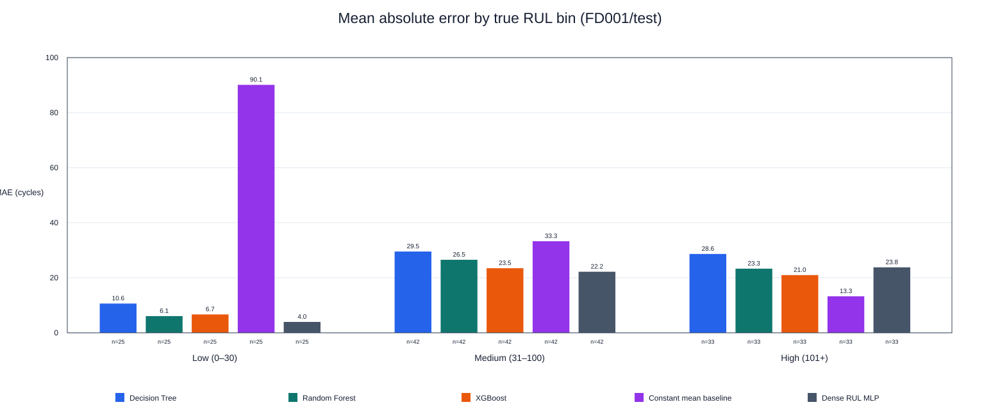

# P25-S2: actual result captions and limitations

This caption packet is for report assembly (P25-S2 / [issue #180](https://github.com/Artfever/FleetpulseAI/issues/180)). It reuses frozen, source-checked P13 and P22 outputs. NASA C-MAPSS FD001 is simulated data. RUL, residual, MAE and RMSE are measured in operating cycles; schedule objective values are weighted cycles.

## Final held-out FD001/test model comparison

| Frozen model | Version | Engines | MAE (cycles) | RMSE (cycles) |
| --- | --- | ---: | ---: | ---: |
| Decision Tree | `decision-tree-rul-v1` | 100 | 24.513306424988755 | 33.95219459227001 |
| Random Forest | `random-forest-rul-v1` | 100 | 20.34970822712025 | 27.51996165541398 |
| XGBoost | `xgboost-rul-v1` | 100 | 18.44893268585205 | **24.16644813405696** |
| Constant mean baseline | `constant-rul-v1` | 100 | 40.87930202123019 | 52.62485752612688 |
| Dense RUL MLP | `dense-rul-mlp-final-v1` | 100 | **18.160531787872316** | 25.573537464442705 |

**Table 1. Final MAE and RMSE on 100 frozen FD001/test engine outputs, with both metrics in operating cycles.** The test scores are final descriptive reporting only; they were not a model-selection input.

On these 100 simulated held-out engines, the MLP has the lowest MAE and XGBoost the lowest RMSE. Both models score better than the constant baseline on both metrics; the tree and forest have higher errors than the MLP/XGBoost pair. MAE and RMSE summarize different error behavior, so the table does not identify a universal winner. The final test scores are reporting only; they were not fed back into model selection or training. The P13 independent audit matched all 500 prediction/label rows and all ten aggregate scores with zero difference.

## Figures for the report

**Figure 1. Raw predicted RUL versus true RUL on the held-out FD001/test set.** One point represents one engine at its greatest observed cycle. Both axes are operating cycles. The dashed diagonal is exact agreement; it is not an uncertainty band. The MLP has the lowest overall MAE in the paired report, while XGBoost has the lowest RMSE. Source: frozen P13 outputs, summarized in [P13-S3](../p13_s3_final_test_results.md) and independently checked by [P13-A2](../p13_a2_independent_metric_audit.md). These scores describe 100 simulated engines, not real fleet performance.

**Figure 2. Per-engine residuals by true RUL, in operating cycles.** Residual is raw prediction minus true RUL: positive values overestimate remaining cycles, and negative values underestimate them. The horizontal zero line is exact prediction. The figure shows errors vary across engines and RUL values; it does not show confidence or explain physical causes. Source and frozen-model provenance: [P22-S1](../p22_s1_error_analysis.md).

**Figure 3. MAE by predeclared true-RUL analysis range.** Low is 0–30 cycles (25 engines), medium is 31–100 (42), and high is 101+ (33). For example, the Decision Tree's MAE is 10.62 cycles in the low bin and 29.53/28.65 in the medium/high bins; the constant baseline is 90.09 in the low bin and 13.27 in the high bin. The groups are descriptive analysis ranges, not maintenance thresholds. Counts are fixed across models. Source: [P22-S1 diagnostics](../p22_s1_error_analysis.md) and the [captioned P22 results summary](../p22_report_results.md).

## Development-validation uncertainty and sensitivity captions

The P22 engine-bootstrap study used the 20 held-out FD001/train validation engines, 10,000 paired whole-engine resamples and seed 42. Decision Tree validation MAE was 22.49 cycles with a 95% aggregate-MAE interval of 14.36–31.06; XGBoost was 15.11 (9.21–22.11); the development MLP was 15.51 (8.70–23.68). These intervals describe resampling variation of aggregate validation MAE conditional on fixed saved fits. They are not per-engine RUL intervals and do not measure retraining variation. See [P22-S2](../p22_s2_engine_bootstrap.md).

In a separate artificial sensor-change study on those same 20 validation prefixes, mean absolute raw-output movement for the development MLP was 557.96 cycles at ±1% and 2,830.33 at ±5%; the largest observed movement was 70,505.38 cycles. Tree/boosting means were about 4–5 cycles. These are model responses to chosen artificial perturbations, not measured sensor noise, error, fault evidence or causation. See [P22-S3](../p22_s3_sensor_sensitivity.md).

## SHAP example caption

| Attribution item | Value |
| --- | ---: |
| Raw final Decision Tree estimate | 29.7941176471 cycles |
| Reference baseline | 126.9360964740 cycles |
| Additivity difference | 0.0000045322 cycles |
| `sensor_13_mean` signed contribution | +6.5856 cycles |
| `sensor_4_mean` signed contribution | -29.4441 cycles |

**Table 2. Local frozen-tree attribution for packaged FD001/train engine 4 through observed cycle 164.** The signed values are the model's allocation relative to a fixed 100-prefix reference sample, using the ordered 96-feature schema. Positive/negative signs describe movement above/below that baseline; they do not show sensor causation, a fault, or the result of physically changing a sensor. Source and method: [P17-S1](../p17_s1_final_tree_explanations.md) and [P17-T1](../p17_t1_feature_contribution_display.md). This is one simulated training-history explanation, not a test score.

## Scheduler comparison caption

P22 compared EDD and seeded GA on 18 fixed simulated fleet/team/buffer scenarios, using the same frozen raw Decision Tree predictions. GA matched EDD in 12 cases and improved weighted tardiness in 6, with zero regressions. Across five seeds per scenario (90 paired comparisons), the counts were 60 ties, 30 improvements and zero regressions; all schedules were feasible and repeated seeds matched.

For a concrete tie, a five-engine, one-team scenario with a two-cycle buffer scored zero weighted tardiness under both methods for every tested seed. For an improvement example, a ten-engine, one-team stress case with a 120-cycle buffer had EDD score 85.102 weighted cycles; the five GA seed results were 61.600, 61.600, 61.600, 65.600 and 67.000 weighted cycles. The 120-cycle buffer and all service durations, priorities, team counts, horizon values and GA settings are scenario assumptions. The schedule scores do not establish global optimality or operational superiority. The source reports document every scenario and seed: [P22-A1](../p22_a1_fixed_fleet_scenarios.md) and [P22-A2](../p22_a2_seed_comparison.md).

## Source and verification record

- Final held-out metrics: [P13-S3 report](../p13_s3_final_test_results.md); [P13-A2 independent arithmetic/row audit](../p13_a2_independent_metric_audit.md). Test-history SHA-256: `3cda7109ce17bafb5443f2ac926cfcf88154b941b8c4cf95eb55d1ddd6f52851`; answer-file SHA-256: `a19c8ec94931949d0485bdc35118206e9c81c4547b422efb9cf86f4ceddbceca`.
- Binned metrics and figures: [P22-S1 report](../p22_s1_error_analysis.md); data in [`p22_s1_error_analysis.json`](../figures/p22_s1_error_analysis.json); three SVGs under `docs/figures/`.
- Validation interval and sensitivity: [P22-S2](../p22_s2_engine_bootstrap.md) and [P22-S3](../p22_s3_sensor_sensitivity.md), with hashes and machine-readable summaries.
- SHAP: [P17-S1](../p17_s1_final_tree_explanations.md); output is for FD001/train engine 4 through cycle 164.
- Schedules: [P22-A1](../p22_a1_fixed_fleet_scenarios.md) and [P22-A2](../p22_a2_seed_comparison.md); snapshots retain scenario and source hashes.
- No new models were trained and no new test scores were calculated for this caption packet. A fresh clone may not include the full ignored histories or model bundles required to regenerate source outputs.
