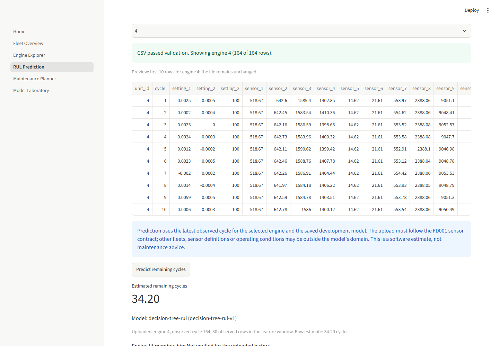
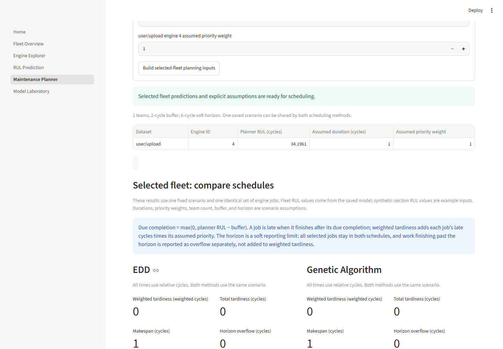

# FleetPulse AI
## Simulated engine histories to RUL estimates and schedule comparisons

Course project · Software-only Path A  
NASA C-MAPSS FD001 simulation data

**Boundary:** outputs are cycle estimates and scenario comparisons, not aircraft fault diagnoses or maintenance recommendations.

<!-- 8–10 minute group presentation. Editable Marp Markdown; export layout still needs human inspection. -->

---

## Problem and users

- Sensor histories evolve over operating cycles.
- A user needs a concise estimate from the observations available so far.
- A planner can compare possible job orders when operating assumptions are explicit.
- FleetPulse is an educational Streamlit prototype for teammates and evaluators.

**Project objective:** connect validated history → saved-model RUL estimate → transparent schedule comparison, with evidence and limitations visible at each step.

---

## What the application lets a user do

1. Inspect a small packaged fleet example or explore an engine history.
2. Upload one history with the exact 26-column FD001 schema.
3. Request a saved-model estimate and inspect its version and observed cutoff.
4. Pass a successful estimate into the planner.
5. Compare EDD and seeded GA on the same jobs and assumptions.
6. Review model and evaluation evidence separately in Model Laboratory.

---

## Data and target: keep answers out of inputs

- `FD001/train`: 100 complete simulated engine histories for development.
- `FD001/test`: 100 different simulated histories, observed only to their final recorded cycles.
- `RUL_FD001.txt`: separate test answers, paired only after predictions are saved.
- Development split: 80 fitting engines, 20 whole engines held out for validation.
- For complete training lifetime `L` and observed cycle `t`, target is `L − t` cycles.

Engine identity includes the partition because unit numbers can repeat. The raw full dataset is not tracked in Git.

---

## Past-only feature pipeline

`past-only-v1` summarizes 24 channels (3 settings + 21 sensors):

**latest · mean · population standard deviation · slope by actual cycle**

24 channels × 4 statistics = **96 ordered numeric features**. The default window is the 30-cycle interval ending at the selected cutoff. Engine ID, cycle, full lifetime, true RUL, and future readings stay outside the feature vector.

```text
Observed cycles 1 ... 164 | hidden future 165 ... 189
Features use observed prefix through 164 | separate training target = 25 cycles
```

---

## Product journey: upload, predict, plan



Recorded local demo: FD001/train engine 4, 164 observed rows through cycle 164. The service returned raw RUL **34.196078 cycles**; UI displays 34.20. Model version: `decision-tree-rul-v1`.

---

## Same uploaded engine passed to the planner



One-job demo: EDD and GA both had zero tardiness and one-cycle makespan. One team, duration 1, priority 1, buffer 2, horizon 6 are illustrative settings.

---

## Model evaluation: two useful error summaries

| Frozen model | Version | MAE (cycles) | RMSE (cycles) |
| --- | --- | ---: | ---: |
| Decision Tree | `decision-tree-rul-v1` | 24.5133 | 33.9522 |
| Random Forest | `random-forest-rul-v1` | 20.3497 | 27.5200 |
| XGBoost | `xgboost-rul-v1` | 18.4489 | **24.1664** |
| Constant mean | `constant-rul-v1` | 40.8793 | 52.6249 |
| Dense MLP | `dense-rul-mlp-final-v1` | **18.1605** | 25.5735 |

100 simulated held-out FD001/test engines. MLP has lowest MAE; XGBoost has lowest RMSE. Final test scores are reporting only; XGBoost selection used development validation RMSE.

---

## Explanation and scheduling evidence

- One final-tree SHAP example: engine 4 through cycle 164, raw RUL 29.7941; reference 126.9361 cycles.
- `sensor_13_mean`: +6.5856 cycles; `sensor_4_mean`: −29.4441 cycles.
- These contributions describe model movement relative to a reference; they are not causes or fault labels.
- On 18 fixed scenarios, GA tied EDD 12 times and improved 6; across 90 seeded comparisons: 60 ties, 30 improvements, 0 regressions.
- Durations, priorities, teams, buffers, and horizon are assumptions, not NASA measurements.

---

## Limits and conclusion

**We can report:** measured errors on the fixed simulated FD001/test sample, one model attribution, and schedule outcomes for declared scenarios.

**We cannot claim:** real-aircraft performance, individual-engine uncertainty, a physical fault, causation, safety, maintenance benefit, or that GA always wins.

The report links each claim to its source output, model/split, units, and limitations. See [assembled report](../report/p25_final_report.md), [P25-S1 details](../report/p25_s1_model_evaluation_scheduling.md), and [P25-S2 evidence captions](../report/p25_s2_evidence_captions.md).

<!-- End with questions on the validation split, MAE vs RMSE, SHAP, and schedule assumptions. The group rehearsal and exported slide inspection are not yet evidenced by this file. -->
